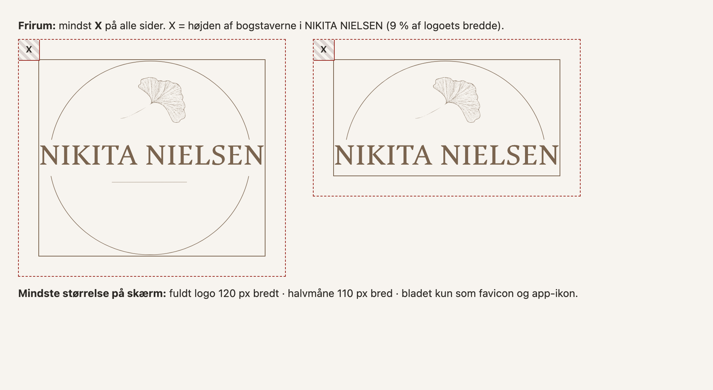

# Nikita Nielsen: brand guide

**Version:** 1.0 draft, 17 Nov 2026 · **Status:** approved by Felix; owner review pending
**Source of truth for values:** [tokens.css](tokens.css). This guide explains how to use them. If the two disagree, the tokens win and this guide is fixed.
**See it:** [brand-board.html](brand-board.html) (open through a local server: `cd ref/brand && python3 -m http.server`, then http://localhost:8000/brand-board.html)
**Why it looks this way:** [Design rationale](../Design-Rationale.md), section "Brand decisions"

---

## 1. Logo

The logo was designed by Felix from the shop's existing identity: the name in Ancizar Serif, a ginkgo leaf and a circle, in Sand. AI only cropped frames and swapped colours; no shape was drawn or changed by AI.

### Variants

| Variant | File | Use |
|---|---|---|
| Full lockup | `logo/logo-full-{sand,ink,paper}.svg` | Hero, footer, emails, print. Anywhere with room |
| Half moon | `logo/logo-half-{sand,ink,paper}.svg` | Navigation bar. Top arc, leaf and name, no lower circle |
| Leaf | `logo/favicon/*.png` | Browser favicon and app icon only |

On the website, use the PNG exports in `logo/web/` (1x, 2x, 3x) for the navbar and footer: the SVG master is 800 KB because of the leaf's fine hatching, too heavy for every page. Use the SVGs for print and large hero images.

### Colour

| Ground | Logo colour |
|---|---|
| Paper | Sand (default) or Ink |
| Linen | Ink. Sand on Linen is only 3.8:1 |
| Sand | Paper |
| Ink | Paper |

The logo is always one colour. Never place it on a photo without a solid ground behind it.

### Clear space and minimum size

- **Clear space:** keep at least **X** empty on every side. X is the height of the capital letters in NIKITA NIELSEN, about 9% of the logo's width.
- **Minimum width on screen:** full lockup **120 px**, half moon **110 px**. Below that the name stops being readable. In a phone navbar this means a bar about 72 px high.
- **Leaf alone:** only as favicon and app icon. Its lines are fine, so it is faint at 16–32 px. This is an accepted limitation (see section 7).

### Don't

- Redraw, stretch, rotate, outline or add effects (shadow, gradient) to the logo.
- Use two colours in one logo, or any colour outside the palette.
- Put the half moon in large places where the full lockup fits.
- Add the phone number or other text inside the circle.

---

## 2. Colour

Paper is the ground. The colour placed on it is split about **60 / 30 / 10** between Linen, Sand and Ink. The palette is the owner's: it comes from her liking for paper. It stays quiet on purpose, so the flowers in the photos bring the colour.

| Token | Hex | Role | Share |
|---|---|---|---|
| `--paper` | `#F7F4EF` | Page background | the ground |
| `--linen` | `#DCD4D1` | Cards, panels, bands | about 60% |
| `--sand` | `#7A644F` | Logo, buttons, links on Paper, feature bands, footer | about 30% |
| `--ink` | `#2D2A26` | Text, selected states, strongest accents | about 10% |
| `--error` | `#9B2C24` | Error messages and invalid fields | functional |
| `--success` | `#36602F` | Confirmations | functional |

In components, use the role tokens (`--color-bg`, `--color-surface`, `--color-text`, `--color-accent`, `--color-on-accent`, `--color-link`, `--color-border`, `--color-error`, `--color-success`), not the palette names.

### Pairings (WCAG 2.1 AA)

The full table is generated from the tokens: [contrast.md](contrast.md). The rules that matter day to day:

| Do | Ratio |
|---|---|
| Ink text on Paper or Linen | 13.0:1 / 9.8:1 |
| Sand text, links and buttons on Paper | 5.1:1 |
| Paper text on Sand (buttons, bands, footer) | 5.1:1 |
| Error and success text on Paper or Linen | 5.0:1 or more |

| Don't | Ratio | Instead |
|---|---|---|
| Sand text on Linen (small text) | 3.8:1 | Ink. Sand on Linen only for large text and borders |
| Ink on Sand | 2.6:1 | Paper on Sand |
| Error or success on Sand or Ink | under 2:1 | Keep messages on Paper or Linen |
| Linen card on Paper with no edge | 1.3:1 | Give the card a 1 px Sand border |

**Focus:** every interactive element shows the two-tone focus ring (`--focus-ring`: Ink ring, Paper halo). It passes on all four grounds.
**Never colour alone:** errors and confirmations always carry text (and may add an icon). Selected states change fill, not only colour.

---

## 3. Typography

Two typefaces, both self-hosted from the shop's own domain (no Google Fonts requests, for speed and GDPR).

| Use | Typeface | Token |
|---|---|---|
| Logo and headings | **Ancizar Serif**, 400–700 (italic available) | `--font-heading` |
| Body, forms, buttons, prices | **Inter**, 400–700 | `--font-body` |

Why Inter and not the system font or Ancizar Sans: body text should read like what people read every day (Jakob's law), and a self-hosted face looks the same on every phone instead of whatever font a device or user has set. Details in the design rationale.

### Scale (16 px base, phone first)

| Token | Size | Use |
|---|---|---|
| `--text-3xl` | 40 px | Front-page heading |
| `--text-2xl` | 32 px | Page headings |
| `--text-xl` | 24 px | Section headings (counts as large text) |
| `--text-lg` | 20 px | Product names, lead text |
| `--text-base` | 16 px | Body text, inputs, buttons. Never smaller for form inputs (stops iPhone zooming in) |
| `--text-sm` | 14 px | Small print, meta. Never for anything a customer must act on |

Weights: 400 regular, 600 semibold (buttons, labels, headings), 700 bold (rare). Line height 1.15 for headings, 1.55 for body.

**Prices** use tabular numbers and Danish formatting: `250 kr.`, `1.250,50 kr.` Amounts are always shown including moms.

---

## 4. Components (starting point)

The brand board shows the base versions. The storefront change builds the real ones from these rules.

- **Primary button:** Sand fill, Paper text, semibold, at least 48 px high, full width on phones. One primary button per screen.
- **Secondary button:** Sand 2 px border, Ink text, no fill.
- **Inputs:** Paper fill, 1 px Sand border, label above in semibold Ink, 16 px text. Invalid: 2 px error border and the message under the field, starting with what to do.
- **Cards:** Paper fill, 1 px Sand border, photo at 4:5.
- **Tier picker (Lille / Mellem / Stor):** three equal buttons with the price under the name; the chosen one is filled Ink with Paper text.
- **Panels:** Linen with Ink text and Ink links. **Bands and footer:** Sand with Paper text and links.

---

## 5. Imagery

Photos are the product (design rationale P6).

- **Only the owner's own photos at launch.** No stock photos and no AI-generated images. Stand-ins may appear on preview builds only, each one listed and replaced before launch.
- **Per bouquet:** a main image on a consistent neutral background, one in hand or on a table to show the size, and one detail.
- **One look across the range:** the same light, angle and background, so the grid reads as one collection.
- **Format:** 4:5 portrait for product images. Always state the size in words too ("ca. 40 cm høj").
- **Not decided:** whether a neutral or a styled main image sells better. We start neutral and treat it as a test.
- **What each photo shows** (Felix, 21 Nov, DD-05):
  - *Occasion photos:* the bouquet only, possibly held in a hand. No people.
  - *Front page hero:* a person working with the flowers, face not shown.
  - *"Besøg Nikita":* Nikita herself, preferably in front of her shop.

---

## 6. Voice (Danish)

Customer-facing text is Danish. Code and internal documents are English.

- **Plain and concrete.** "Levering i Holbæk og omegn koster 80 kr." beats "Vi leverer smukke blomster til hele området". Facts are what both customers and AI search tools can quote (P10).
- **Du-form,** short sentences, warm but not sugary. No exclamation marks in running text.
- **Say what happens next,** especially around delivery date, cut-off time and payment: "Bestil inden kl. 12 for levering i dag."
- **Calm for sad occasions.** On sympathy and funeral pages, no cheerful extras: just what to choose, when it arrives and what to write on the card.
- **Nothing invented.** No claims, reviews, testimonials or promises the owner has not made. Placeholders are marked as such.
- **Error messages** say what to do: "Vi leverer ikke til 8000. Vælg afhentning i butikken i stedet."

---

## 7. Known limitations

- **The logo is weak at small sizes.** It was given, not designed in this project. The leaf's fine hatching turns faint at favicon size, and the SVG is heavy. Felix decided not to add a simplified leaf: one more drawing would be one style too many. Had the brief been to design a new logo, a mark made for 16 px would have been worth considering.
- **Functional colours** (error, success) are accepted "for now" and may be revisited after the usability test in week 5.

---

## 8. Licences

| Element | Licence | Holder | Source |
|---|---|---|---|
| Logo artwork | Original work by Felix, made for the shop. Rights to be confirmed in writing and handed to the owner at hand-over | Felix, for Nikita Nielsen | `ref/brand/Logo.svg` |
| Palette | No licence needed; chosen for the shop | Nikita Nielsen | `ref/COLORS.png` |
| Ancizar Serif | SIL Open Font License 1.1 | The Ancizar Serif Project Authors (Universidad Nacional de Colombia) | github.com/UNAL-OMD/UNAL-Ancizar |
| Inter | SIL Open Font License 1.1 | The Inter Project Authors (Rasmus Andersson) | github.com/rsms/inter |

Both font licences allow commercial use, self-hosting and subsetting. The licence texts are in `fonts/source/`. Ancizar Sans and Instrument Sans in the same folder were only compared on the specimen and are not used.
